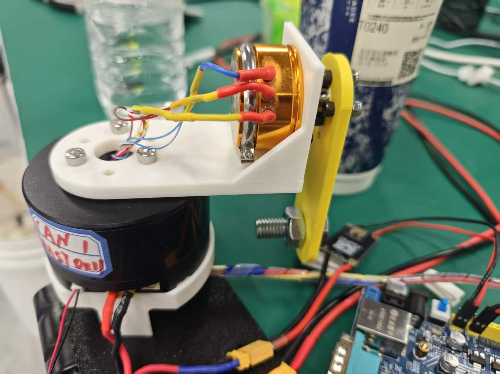
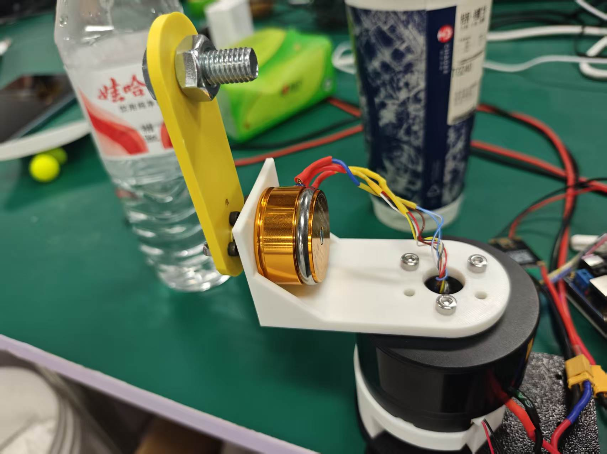
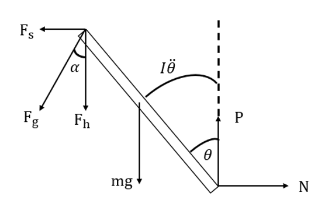

# 倒立摆控制实验

# DM\-G220 倒立摆物理系统设计

单级直线倒立摆：**达妙 DM\-G6220 电机驱动横杆左右移动，横杆上铰接的摆杆由电位器测角，串级 PID 让摆杆保持竖直向上，同时把横杆稳定在目标位置。**

- 内环（角度环）：稳住摆杆 —— 摆杆偏离竖直越远，电机越快地把横杆抽到摆杆下方。

- 外环（位置环）：稳住横杆 —— 横杆偏离目标位置时，给角度环叠加一个小倾斜角给定，让系统通过"往目标方向微微倾斜"把横杆拉回来。

- 如果只有单角度环，可以直立，不过一般过一段时间就会发散倒下。

---





## 硬件与平台

|项目|说明|
|---|---|
|MCU|STM32F429IGT6 @ 180 MHz（HSE 25 MHz，PLL N=360）|
|执行器|达妙 DM\-G6220 电机 ×1（`Motor1`，CAN ID `0x01`，主站 ID `0x11`），运行在 **速度模式（spd\_mode）**|
|角度传感器|摆杆铰链处的回绕式电位器，接 **ADC1\_CH5**，12 位（0\~4095）|
|通信|经典 CAN1 @ 1 Mbps|
|显示|板载 LCD（FMC 驱动），显示角度 / 位置 / ADC / 目标|
|调试|J\-Link \+ J\-Scope 实时波形（`DATA.jscope`），数据落盘到 `data_csv/`|

### 定时/采样

|定时器|配置|用途|
|---|---|---|
|TIM3|90 分频，周期 1000 → **1 ms 中断**|控制主循环，每拍发一帧电机控制帧|
|ADC1|连续转换 \+ DMA 循环搬运|后台把电位器原始值写进 `ADC_Value`，不占 CPU|

---

## 目录结构

```Plaintext
Core/            应用入口与 CubeMX 生成的外设初始化（main.c、adc/tim/can/gpio…）
BSP/DM_Motor/    DM 电机驱动（MIT 协议、CAN 收发、多圈位置展开）
BSP/PID/         通用 PID（位置式/增量式、积分分离、D 项滤波）
BSP/TASK/        ★ 倒立摆核心：串级 PID、角度换算、零点标定、控制中断
BSP/LCD/         LCD 驱动与字库
BSP/KEY/         按键扫描
BSP/IIC/         I2C（软件模拟）
BSP/Motion/      台头动画序列（倒立摆工程中未使用，历史遗留）
Drivers/         STM32 HAL / CMSIS
MDK-ARM/         Keil 工程与编译输出（输出内容已 gitignore）
data_csv/        J-Scope 导出的整定数据与波形截图
```

核心逻辑集中在 BSP/TASK/task\.c，参数与结构说明见 BSP/TASK/task\.h。

---

## 控制方案

### 串级结构

```Plaintext
pos_pid.set               角度环给定 angle_pid.set
目标位置 ──►[外环·位置环]──► 目标倾斜角 ──►[内环·角度环]──► 速度给定 ──► DM-G6220
                ▲                              ▲
             motor_pos                       angle
          （连续坐标 rad）              （相对竖直向上, rad）

外环 20 ms   Ki=0       内环 5 ms
```

- **内环·角度环**：输入摆杆角（rad，竖直向上 = 0），位置式 PID，输出直接作为电机**速度给定** `motor[Motor1].ctrl.vel_set`。

- **外环·位置环**：输入横杆位置（rad，连续坐标），输出作为角度环的**目标倾斜角** `angle_pid.set`。

- 两环均为位置式 PID，带**积分分离**（`|误差| > I_band` 时关掉积分，抑制大误差下的积分饱和）。

### 关键实现细节

- **角度换算**：`pendulum_angle_rad()` 把 ADC 原始值减去标定中点得到有符号差，并对 ±2048 做回绕修正（电位器 360° 满量程 → 2π rad）。

- **多圈连续位置**：`dm_motor_pos_cont()` 把电机回绕位置展开为可多圈的连续坐标。**位置环必须用连续值** —— 用回绕值会在跨圈时给环一个 2π 阶跃冲击。LCD 上另有 `PosW/TgtW` 是显示层的 ±π 回绕，仅供观察、不参与控制（`wrap_pi_display()` in `main.c`）。

- **零点标定**：`motor_pos_zero()` 记录当前连续位置为零点偏移，并把位置目标一并清零。**这是唯一取零入口**，由 KEY0 触发。

- **倒杆保护**：摆杆偏过水平（`|角度| > π/2`）时立即停机、清零延时寄存器并点亮绿灯。

---

## 上电流程与操作

**上电流程**（`main()` in Core/Src/main\.c）：

1. 初始化外设 → LCD 打印静态标签 → 启动 ADC1 DMA 连续采集。

2. `dm_motor_init()` → `pendulum_pid_init()`：初始状态为**停机**（`run_state = 0`），避免上电乱动。

3. 设置 `Motor1` 为速度模式，延时 1 s 后使能电机，启动 TIM3 1 ms 中断。

**操作**（按键在 `while(1)` 中轮询）：

|按键|功能|
|---|---|
|**KEY3**|翻转运行状态：启动 / 停止平衡控制|
|**KEY0**|把当前电机位置设为原点（同时把位置目标清零），并置位 `delay_position_register` 使位置环开始工作|
|**KEY1**|位置目标 \+`POS_TARGET_STEP`（0\.05 rad）|
|**KEY2**|位置目标 −`POS_TARGET_STEP`（0\.05 rad）|

**推荐操作顺序**：扶正摆杆 → 按 KEY3 启动角度环 → 稳一下 → 按 KEY0 取零并接入位置环 → 用 KEY1/KEY2 给位置目标。

**LED 指示**：

|LED|含义|
|---|---|
|红灯 LED\_R|常亮 = 平衡控制运行中，灭 = 停机|
|绿灯 LED\_G|灭 = 位置环已接入；亮 = 位置环未接入或已倒杆停机|

**LCD 显示**：`Ang`（摆杆角 rad）、`Pos`（横杆位置·连续坐标）、`PosW`（横杆位置·±π 回绕）、`ADC`（电位器原始值，标定中点看这一行）、`Tgt`（位置目标·连续）、`TgtW`（位置目标·±π）。

---

## 参数整定

所有 PID 参数与标定常数集中在 BSP/TASK/task\.c 顶部两组 `#define` 中：

```C
/* 传感器标定 */
PENDULUM_CENTER_ANGLE   // 摆杆竖直向上时的 ADC 原始值（实测值，上电后看 LCD 的 ADC 行标定）
PENDULUM_FALL_ANGLE     // 倒杆判定阈值，默认 π/2
PENDULUM_DIR            // 电机转向系数，摆杆反方向失衡时改为 -1.0f

/* 内环·角度环（输入 rad，输出 → 速度给定）*/
ANGLE_KP / ANGLE_KI / ANGLE_KD / ANGLE_MAX_OUT / ANGLE_MAX_IOUT / ANGLE_I_BAND

/* 外环·位置环（输入 rad，输出 → 目标倾斜角 rad）*/
POS_KP / POS_KI / POS_KD / POS_MAX_OUT / POS_MAX_IOUT / POS_I_BAND
```

整定经验（来自当前代码注释与提交记录）：

- 角度环 D 项采用"每采样差分"，量级被 `1/5ms` 放大，所以 `ANGLE_KD` 数值很大（400 量级）属正常。

- `ANGLE_KP` 曾用纯 KP = 67 手动调；`ANGLE_KI` 用 Ziegler\-Nichols 法整定为 1\.227。

- 位置环增益很小（`POS_KP ≈ -0.05`、`POS_KD ≈ -0.10`），符号与外环方向有关；`POS_MAX_OUT` 限制最大目标倾斜角（默认 3 rad）。

- 改采样率（TIM3 分频）后，D 项等效增益随之改变，需重新整定。

**调试工具**：J\-Link \+ J\-Scope（工程文件 `DATA.jscope`，监视符号 `angle`），整定过程数据存于 `data_csv/`（含 `kp_67_swing_equal.csv`、`pid_angle_zn.csv` 及对应波形 PNG）。

---

## 编译与烧录

1. 用 Keil µVision 打开 `MDK-ARM/inverted_pendulum` 工程。

2. 编译（输出目录与派生产物已 gitignore）。

3. 通过 J\-Link 烧录，需要实时看波形时用 J\-Scope 加载 `inverted_pendulum.axf` 与 `DATA.jscope`。

---

## 已知状态 / 待办

- 位置环与角度环的耦合增益仍在整定中（近期提交："位置环粗调"、"再次调整 pid 参数位置环"）。

- 没有实现自动起摆功能

# 倒立摆数学建模 固高科技

> 对于倒立摆系统，经过小心的假设忽略掉一些次要的因素后，它就是一个典型的运动的刚体系统，可 
> 
> 以在惯性坐标系内应用经典力学理论建立系统的动力学方程。下面采用其中的牛顿—欧拉方法建立直线一 
> 
> 级倒立摆系统的数学模型。此处也可以应用拉格朗日法进行建模。
> 
> 


> N和P为小车与摆杆相互作用力的水平和垂直方向的分量
> 
> 

|符号|意义|实际数值|
|---|---|---|
|M|小车质量|1\.096kg|
|m|摆杆质量|0\.109kg|
|f|小车摩擦力|0\.1N/m/sec|
|L<br>I|摆杆转动轴心到杆质心的长度<br>摆杆惯量|0\.25m<br>0\.00223kg\*m\*m|
|F|加在小车上的力||
|x|小车位置||
|q<br><br>F\(s\)|摆杆与垂直向上方向的夹角 （考虑到摆杆初始位置为竖直向下）<br>摆杆受到水平方向上的干扰力|<br><br>|
|F\(h\)|摆杆受到垂直方向上的干扰力||
|Fg<br>g|F\(s\)与   F\(h\)的合力<br>重力加速度|<br>9\.8m/s\(2\)|




- 分析小车水平方向所受的合力，可以得到以下方程


## 微分方程

## 传递函数

## 状态空间

$\begin{bmatrix}\dot{x} \\\ddot{x} \\\dot{\varphi} \\\ddot{\varphi}\end{bmatrix}=\begin{bmatrix}0 & 1 & 0 & 0 \\0 & 0 & 0 & 0 \\0 & 0 & 0 & 1 \\0 & 0 & \frac{3g}{4l} & 0\end{bmatrix}\begin{bmatrix}x \\\dot{x} \\\varphi \\\dot{\varphi}\end{bmatrix}+\begin{bmatrix}0 \\1 \\0 \\\frac{3g}{4l}\end{bmatrix}\ddot{x}$

$y=
\begin{bmatrix}
x \\
\phi
\end{bmatrix}=
\begin{bmatrix}
1 & 0 & 0 & 0 \\
0 & 0 & 1 & 0
\end{bmatrix}
\begin{bmatrix}
x \\
\dot{x} \\
\phi \\
\dot{\phi}
\end{bmatrix}+
\begin{bmatrix}
0 \\
0
\end{bmatrix}
\begin{bmatrix}
\ddot{x}
\end{bmatrix}$

> 此处x表示小车位置，φ表示摆杆倾角
> 
> 

## 控制方法

- 控制倒立摆的核心 = 找到"加速度该怎么给"的规律

## 状态空间的极点配置方法

## 状态空间的LQR控制方法

### LQR基础知识

> - LQR 问题的解是一个全状态反馈调节器，有非常好的鲁棒性能。它可以通过适当选取权矩阵 *Q *和 *R *， 
> 
> - 在控制信号能量和输出性能之间进行调节。 利用 MATLAB 的 LQR 函数可以很方便、准确地求出 LQR 的解—— *K *阵。LQR 线性二次型最优调节器通过选取权矩阵 *Q *和 *R *使求解的全状态反馈阵 *K *与系统的性能指标联系 
> 
> - 起来，其实质是设计最优的全状态反馈阵，比全状态反馈调节器更易设计出鲁棒性更强的控制系统
> 
> - 缺点：需要精确的数学模型
> 
> 


```MATLAB
K = lqr(A, B, Q, R)
```

- 这里理解输入输出有几个重要的点

> *u*=施加在小车上的力/加速度指令 是输入
> x=系统状态，内部变量
> y=系统输出，从系统出去 是给人看的，不是给控制器用的
> 
> $u=-Kx=-k_1x_1-k_2x_2-k_3x_3-k_4x_4$是最后传出去的加速度，送给控制器的变量
> 
> 

### QR矩阵的选取

- Q的维数与状态变量数相同，方矩阵，对此系统为4X4矩阵

- R的维数和输入数相同，对此系统为一个1X1矩阵

- `Q = diag([100, 1, 100, 1])`一般按照物理重要性排序，数字越大表示越重视

- 真正起作用的是Q和R之间的比值

### 如何跟踪非零值

- 原因是LQR本质上是状态反馈，如果想跟踪输出，必须使用输出反馈控制

- 对于此倒立摆，只能收敛到0。

- 如果想跟踪非0值，需要误差反馈，或者加上积分器

### LQR的Simulink仿真

```MATLAB
clear;
A=[0   1    0    0
   0   0    0    0
   0   0    0    1
   0   0   29.7  0]
B=[0 
    1
    0 
    3];
C=[1 0 0 0
    0 1 0 0
    0 0 1 0
    0 0 0 1];
D=[0 0 0 0]';
dt=0.005;
for i=1:801;  
   U(:,i)=[ 5];  
   T(i)=i*dt;
end;  
R=1  ;
Q=[500 0 0 0 ;0 30 0 0;0 0 50 0;0 0 0 10];
K=lqr(A,B,Q,R)
Ak0=[(A-B*K)];
Bk0=[B];
Ck0=[C];
Dk0=[D];
x=[0 0 0 0]';
dt=0.005;%离散时
sys=ss(Ak0,Bk0,Ck0,Dk0);
[Y,X]=lsim(sys,U,T);
h=plot(T,-Y)
grid on;
title(' LQR 控制');
legend('Cart','VCart','single','Vs');
```


### LQR控制的优点

- 倒立摆系统鲁棒性特别好，随便用手拽着都能平衡。

